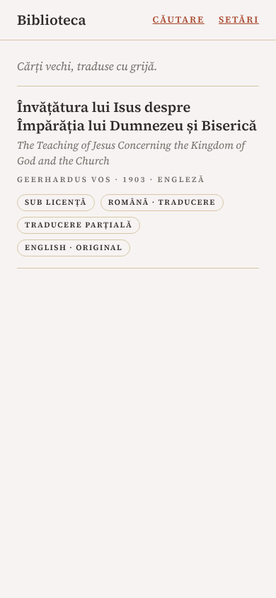
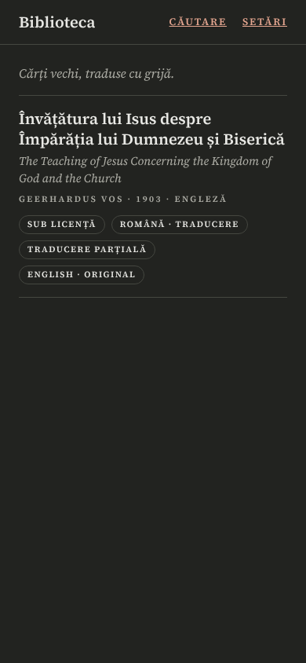
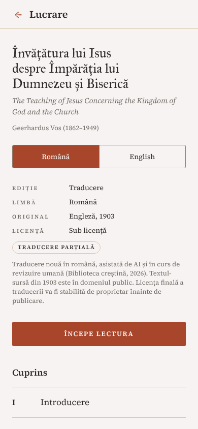
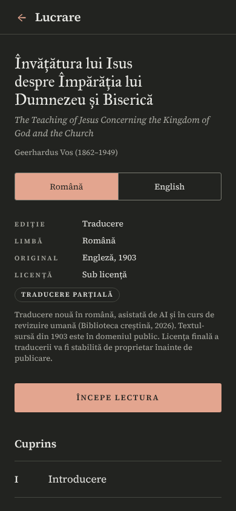
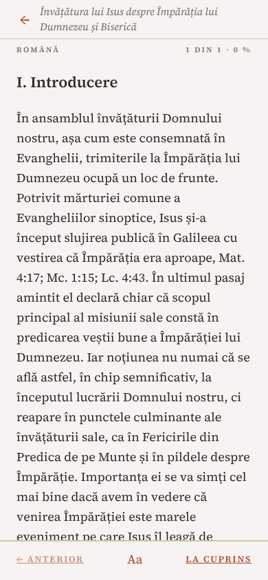
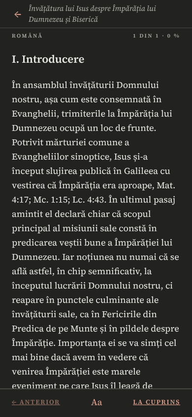
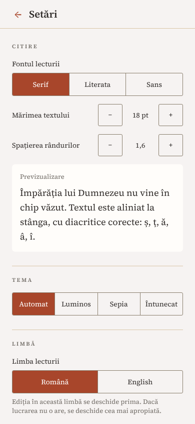
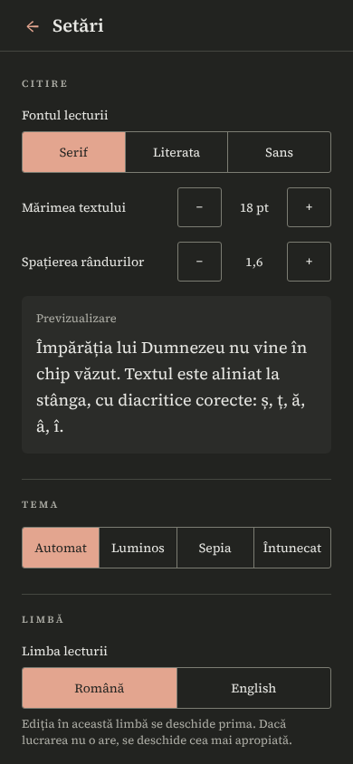

# Biblioteca creștină

Aplicație de bibliotecă creștină (cărți vechi traduse în română + Biblie + asistent AI), livrată pentru iOS, Android și web dintr-un singur cod (Expo). Arhitectura: `docs/arhitectura-app-biblica.md`. Reguli de lucru: `CLAUDE.md`. Specificația M0: `docs/m0-spec.md`. Decizii: `docs/decizii.md`. Securitate: `docs/security.md`.

## Capturi de ecran (exportul web)

Interfața v2 (`docs/ui-spec-v2.md`: hârtie caldă, IM Fell Great Primer și Source Serif 4, terracotta ca unică culoare de accent), tema luminoasă și cea întunecată, una lângă alta, la mărime de telefon (390×844). Variantele de desktop (1366×900) și cele în tema sepia sunt în `docs/screenshots/v2/<ecran>-<temă>-<mărime>.png` (`phone`, `desktop`); toate se regenerează cu `node scripts/screenshots-web.mjs` (după `pnpm --filter mobile export:web`; `--schemes light,dark,sepia`, `--sizes phone,desktop,tablet`). Kit-ul de componente (butoane, chip-uri, tab-uri, pictograme, hero, benzi) este în `docs/screenshots/v2/components-*.png`.

| Ecran                | Luminos                                                                                                  | Întunecat                                                                                                |
| -------------------- | -------------------------------------------------------------------------------------------------------- | -------------------------------------------------------------------------------------------------------- |
| Biblioteca           |          |          |
| Lucrarea și cuprinsul |       |       |
| Cititorul            |           |           |
| Setări               |          |          |

## Structură

| Cale                     | Conținut                                                                      |
| ------------------------ | ----------------------------------------------------------------------------- |
| `apps/mobile`            | aplicația Expo (iOS, Android, web), Expo Router, `src/app`                    |
| `packages/shared`        | scheme Zod (`PackManifest`, `Pack`), `stableId`, `canonicalJson`              |
| `packages/content-tools` | CLI: `ingest-text`, `build-pack`, `verify-pack`, `keygen`                     |
| `content/`               | surse și lucrări canonice (cheile private în `content/keys/`, ignorat de git) |
| `supabase/`              | migrări și teste pgTAP (schiță, neaplicată în M0); vezi `supabase/README.md`  |
| `scripts/`               | verificări de CI (env public, audit, smoke și temă Playwright, mărimea fonturilor), pregătire Pages, capturi, pictograme |
| `.github/workflows`      | `ci.yml`, `web-pages.yml`, `android-apk.yml`, `supabase-tests.yml` (manual)   |

## Rulare pe fiecare platformă

Cerințe: Node 22, pnpm 10. Expo Go nu este folosit (ADR din `docs/decizii.md`): modulele native cer un build de dezvoltare. Directoarele `ios/` și `android/` nu sunt comise (Continuous Native Generation), se generează cu `expo prebuild`.

```bash
scripts/pnpm-install.sh          # sau: pnpm install
```

**Web** (cel mai simplu, nu cere nimic în plus):

```bash
pnpm --filter mobile web         # server de dezvoltare în browser
pnpm --filter mobile export:web  # export static în apps/mobile/dist
```

**Android**:

- Fără SDK local: descarcă APK-ul de test construit de GitHub Actions (secțiunea „APK de test" de mai jos).
- Cu Android Studio / SDK și un emulator sau telefon cu depanare USB: `cd apps/mobile && npx expo run:android` (generează `android/`, construiește un build de dezvoltare și îl instalează). Apoi `pnpm --filter mobile android` pornește serverul Metro.

**iOS** (cere macOS, Xcode și, pentru un telefon real, un cont Apple Developer; CI nu construiește iOS în M0):

- `cd apps/mobile && npx expo run:ios` (simulator) apoi `pnpm --filter mobile ios`.
- Codul rulează pe iOS, dar în acest depozit iOS este acoperit doar de testele Jest.

## Pachete de conținut

Cărțile sunt livrate ca pachete semnate (`pack.json` + `manifest.json`, Ed25519 + sha256) în `apps/mobile/assets/packs/`. Aplicația verifică semnătura la încărcare și nu afișează un pachet neverificat. Comenzile (din rădăcina depozitului; detalii în `packages/content-tools/README.md`):

```bash
CT="pnpm --filter @biblioteca/content-tools cli"

# 1. text brut din PDF (-layout păstrează indentarea, folosită pentru paragrafe)
pdftotext -layout carte.pdf content/sources/<slug>/raw-layout.txt

# 2. curățare -> JSON canonic (ID-urile existente rămân stabile la rulări repetate)
$CT ingest-text content/sources/<slug>/raw-layout.txt --work content/works/<slug>/work.json --verbose

# 3. generare cheie de dezvoltare (o singură dată; cheia privată rămâne în content/keys/, ignorat de git)
$CT keygen --name dev --id dev-2026-11

# 4. construire + semnare, apoi verificare
$CT build-pack content/works/<slug>/edition-en.json --out apps/mobile/assets/packs/<slug>-en
$CT verify-pack apps/mobile/assets/packs/<slug>-en
```

Apoi adaugă pachetul în `apps/mobile/src/content/bundled-packs.ts`. Cheile publice acceptate sunt fixate în `apps/mobile/src/content/trusted-keys.ts` (cheia curentă și una următoare); un test le ține sincronizate cu `content/keys/*.pub`. Pentru semnarea din CI se folosește `build-pack --key-env <VARIABILĂ>`, fără a comite vreodată cheia privată. Cheia de dezvoltare trebuie înlocuită înainte de o distribuire reală (ADR-007).

## Verificare locală

```bash
pnpm install --frozen-lockfile
pnpm -r typecheck
pnpm -r lint
pnpm -r test                     # Vitest (packages) + Jest (apps/mobile)
pnpm format:check                # pnpm format pentru a formata

node scripts/check-public-env.mjs   # nicio valoare EXPO_PUBLIC_* nu arată a secret (sursă)
node scripts/check-public-env.mjs --env --dist apps/mobile/dist   # + mediul curent și bundle-ul exportat
node --test scripts/*.test.mjs      # testele scripturilor
node scripts/audit-gate.mjs         # pnpm audit --prod, nivel moderate (vezi docs/security.md)

pnpm --filter mobile export:web
node scripts/smoke-web.mjs          # Playwright: biblioteca listează o lucrare, cititorul arată paragrafe
node scripts/check-web-theme.mjs    # Playwright: antet, fundal și text din aceeași paletă, luminos și întunecat; prima pictură, focus, stări ARIA
node scripts/screenshots-web.mjs    # capturile din docs/screenshots (luminos/întunecat, telefon/desktop)
node scripts/measure-fonts.mjs      # mărimea fonturilor livrate în export (prima pictură, la cerere, total); --markdown tipărește tabelul din README
node scripts/generate-icons.mjs     # pictogramele aplicației din apps/mobile/assets/images (doar când se schimbă marca sau paletele)
```

Smoke-ul pornește `serve` pe un port liber, deschide exportul în Chromium și iese cu cod diferit de zero la orice eșec (la eșec salvează o captură în `test-results/`). Prima dată pe un calculator nou: `pnpm exec playwright install chromium`. Opțiuni: `--dist <dir>`, `--base-path /biblicapp`, `--port <n>`; `SMOKE_CHROMIUM_PATH` indică un alt executabil Chromium. `check-web-theme.mjs` și `screenshots-web.mjs` au aceleași opțiuni (`check-web-theme.mjs` mai primește `--only <text>`, ca să ruleze doar scenariile al căror nume conține textul; `screenshots-web.mjs` mai primește `--out`, `--screens`, `--schemes`, `--sizes`) și folosesc propriul server static cu revenire la `index.html` pentru rute (exportul este o aplicație single-page).

Simularea locală a ceea ce se publică pe GitHub Pages (bază = numele depozitului, aici `/biblicapp`; `404.html`, deep link):

```bash
EXPO_PUBLIC_WEB_BASE_URL=/biblicapp pnpm --filter mobile export:web --output-dir /tmp/pages-dist
node scripts/prepare-pages.mjs /tmp/pages-dist
node scripts/smoke-web.mjs --dist /tmp/pages-dist --base-path /biblicapp
```

## GitHub: CI, site web, APK

| Workflow           | Când                         | Ce face                                                                                                  |
| ------------------ | ---------------------------- | -------------------------------------------------------------------------------------------------------- |
| `ci.yml`           | push pe `main`, orice PR     | instalare înghețată, verificare env public, typecheck, lint, format, Vitest + Jest, verificare pachet, export web, smoke Playwright, verificare de temă Playwright; job separat de audit |
| `web-pages.yml`    | push pe `main`, manual       | export cu baza `/<nume depozit>` (derivată în workflow), `.nojekyll` + `404.html`, smoke și verificare de temă pe ce se publică, deploy pe GitHub Pages    |
| `android-apk.yml`  | push pe `main`, tag `v*`, manual | `expo prebuild`, `./gradlew assembleRelease`, APK ca artefact; pe tag `v*` îl atașează la un GitHub Release |
| `supabase-tests.yml` | doar manual                | pornește stack-ul Supabase local, aplică migrările, rulează pgTAP                                        |

### Activarea GitHub Pages (o singură dată)

Workflow-ul `web-pages.yml` nu poate activa Pages cu `GITHUB_TOKEN`. În depozit: **Settings, Pages, Build and deployment, Source: GitHub Actions**. Alternativ, cu GitHub CLI: `gh api -X POST repos/<owner>/<depozit>/pages -f build_type=workflow`. După primul deploy reușit, site-ul este la `https://<owner>.github.io/<depozit>/`. Depozitele private cer un plan GitHub care permite Pages.

Aplicația este exportată ca single-page (`web.output: 'single'`: un singur `index.html`, fără pre-randare, deci fără hidratare; vezi ADR-UI din `docs/decizii.md`). GitHub Pages nu are rescrieri, deci `404.html` (o copie a lui `index.html`, generată de `scripts/prepare-pages.mjs`) pornește aplicația pentru linkuri directe precum `/<depozit>/read/<id>/<secțiune>`. Pagina `.nojekyll` este adăugată și ea.

### APK de test

1. Deschide Actions, workflow-ul **Android APK**, ultima rulare reușită, secțiunea Artifacts, `biblioteca-apk` (descărcarea cere autentificare GitHub; artefactul se păstrează 30 de zile).
2. Dezarhivează și copiază `.apk` pe telefon (sau `adb install -r biblioteca-*.apk`). Android cere permisiunea „Instalează aplicații necunoscute" pentru aplicația cu care îl deschizi.
3. APK-ul este semnat cu cheia de **debug** a șablonului (ADR-003): este doar pentru testare, nu poate fi publicat în Google Play. Pe un tag `v*` (de exemplu `git tag v0.1.0 && git push origin v0.1.0`) același APK apare și într-un GitHub Release.

Primul build durează mult (descărcare SDK/NDK, compilare nativă); cache-ul Gradle accelerează rulările următoare. iOS nu este construit în CI în M0 (cere macOS și cont Apple Developer).

## Fonturi

Interfața folosește IM Fell Great Primer (titluri; există numai greutatea 400) și Source Serif 4 (text și interfață), cu Literata și Inter ca opțiuni de lectură (setarea „Fontul lecturii”) și Gentium Plus pentru greaca politonică (se încarcă la deschiderea unei ediții grecești). Fișierele TTF vin din pachetele npm `@expo-google-fonts/*`, fixate exact, și sunt livrate în exportul web (nu din CSS-ul Google Fonts, a cărui felie `latin` pierde `ă ș ț`). Prima pictură așteaptă numai cinci fișiere; restul se încarcă la cerere cu `Font.loadAsync` (`apps/mobile/src/theme/fonts.tsx`, `docs/ui-spec-v2.md` secțiunea 2.2).

Mărimea livrată, măsurată pe exportul web din 4 noiembrie 2026 cu `node scripts/measure-fonts.mjs` (după `pnpm --filter mobile export:web`; scriptul iese cu cod diferit de zero dacă prima pictură depășește 1.400 KiB sau totalul 6.144 KiB, iar în GitHub Actions scrie tabelul și în sumarul jobului):

| Familie | Fișiere | KiB | Rol |
| --- | ---: | ---: | --- |
| IMFellGreatPrimer | 2 | 446 | titluri (prima pictură) |
| SourceSerif4 | 4 | 1051 | text și interfață (prima pictură, în afară de italicul 600) |
| Literata | 5 | 1245 | opțiune de lectură, la cerere |
| Inter | 3 | 1005 | opțiunea de lectură „Sans”, la cerere |
| GentiumPlus | 2 | 1609 | ediții grecești, la cerere |
| **Total livrat** | **16** | **5357** | 5,23 MiB în exportul web |
| din care prima pictură (se așteaptă) | 5 | 1294 | 1,26 MiB |
| din care la cerere (`Font.loadAsync`) | 11 | 4063 | 3,97 MiB |

Înainte de interfața v2 exportul livra 8 fișiere (Literata și Inter, 2,20 MiB), toate așteptate la prima pictură. Acum totalul livrat este mai mare (5,23 MiB: fonturile noi, plus Gentium Plus pentru greacă), dar prima pictură așteaptă doar 1,26 MiB, iar restul se descarcă numai când cititorul alege Literata sau Inter ori deschide o ediție grecească.

## Securitate

Baseline-ul și ce este amânat: `docs/security.md`. Pe scurt: fără secrete în repo (`.env.example` conține doar valori publice), pachete de conținut semnate Ed25519 și verificate în aplicație, Dependabot săptămânal, audit de dependențe în CI, permisiuni minime în workflow-uri, schema Supabase cu RLS implicit refuzat (neaplicată încă).
